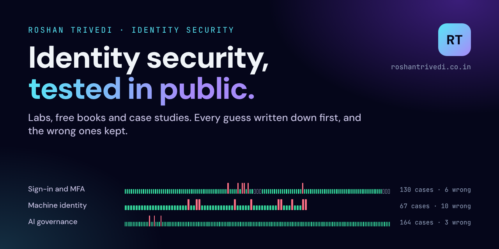

  

  
  
  
  
  

The source of [roshantrivedi.co.in](https://roshantrivedi.co.in), Roshan Trivedi's site on privileged access, machine identity, sign-in and AI agents. It holds four public labs, five free books, 22 case studies and the writing. Every lab follows the same rule: the guess is written down and committed before the test runs, and the wrong guesses stay on the page.

## What is in it

| | Where | What it is |
|---|---|---|
| 🔐 | [`ca-mfa-lab/`](ca-mfa-lab/) | Conditional access, MFA and AI agent lab: 130 cases, 124 run, 6 wrong guesses. Runs in the browser. |
| 🤖 | [`nhi-lab/`](nhi-lab/) | Machine identity lab: 67 cases on service accounts, keys, tokens and break-glass. 10 wrong guesses. |
| 🧭 | [`ai-governance-lab/`](ai-governance-lab/) | AI governance lab: 13 rounds, 164 cases on made-up Indian data. |
| ✋ | [`mcp-lab/`](mcp-lab/) | HumanGate MCP lab: a human approval gate for AI tool calls, 81 use cases and 210 scripted checks. |
| 📚 | [`book/`](book/), the lab folders | Five free books, 71 to 138 pages, as PDFs and on the web. |
| 🗂️ | [`case-studies/`](case-studies/) | 21 practitioner guides, written without employer or client data. With the exam security research in [`secure-india-exams/`](secure-india-exams/), they make the 22 case studies. |
| ✍️ | [`_posts/`](_posts/) | The writing, built by Jekyll and served under `/writing/`. |
| 🧰 | [`scripts/`](scripts/) | The Python that builds pages, books, share images, bundles and checks. |
| 📊 | [`data/`](data/) | `stats.json` (every number the site quotes) and `catalogue.json` (every lab case and whether the guess held). |

Every case in every lab is in one filterable list at [/labs/cases/](https://roshantrivedi.co.in/labs/cases/).

## How it is built

- **Plain HTML first.** Most pages are hand-editable HTML. Only the posts go through Jekyll, which GitHub Pages runs on every push to `main`.
- **Generated parts are marked.** Anything a script writes sits between comment markers, for example `<!-- cs-glance:start -->`. Edit the script or its data, not the marked block.
- **Stylesheets are bundled.** Each page's stylesheets are joined into one `assets/b-HASH.css` file. Edit the source CSS or the commented link list at the top of the page, then run `python3 scripts/bundle-css.py`.
- **The home page CSS is inline** for a fast first paint on phones. Edit `assets/home2.css`, `fonts.css` or `chatbot-widget.css`, then run `python3 scripts/inline-home-css.py`.
- **Cloudflare sits in front.** It serves the security headers (the source copy is `_headers`) and a managed robots.txt that blocks AI training crawlers and AI assistants. Search engines are allowed.
- **Light on readers.** Page counts come from Cloudflare Web Analytics, which sets no cookies; the [privacy page](https://roshantrivedi.co.in/privacy/) says what it records. There are no ad or social scripts. The chat helper answers from the site's own pages in the browser, with no API behind it.

## Checks on every pull request

[`.github/workflows/links.yml`](.github/workflows/links.yml) runs these. The same scripts run locally from the repo root.

| Check | Script |
|---|---|
| Internal links point at real files | `scripts/check-links.py` |
| Every number agrees with `data/stats.json` | `scripts/check-numbers.py` |
| Every public page is in the sitemap | `scripts/build-sitemap.py --check` |
| No key-shaped secrets in tracked files | `scripts/check-secrets.py` |
| No new raw colours outside `assets/tokens.css` | `scripts/check-colours.py` |
| Stylesheet bundles and the home page's inline CSS are current | `scripts/bundle-css.py --check`, `scripts/inline-home-css.py --check` |
| Lab results strips match the catalogue | `scripts/build-results-strip.py --check` |
| Case study flows and callouts are current, and quote the study word for word | `scripts/case-glance.py --check` |
| Videos have a size, a name and structured data; every page shows a date | `scripts/fix-video-tags.py --check`, `scripts/add-reviewed.py --check` |
| Pages lay out at 320, 390 and 1280 px with no new problems | `scripts/check-pages.py` (Playwright) |
| The Jekyll build works | `jekyll build` |

## Editing

- **Change words on a page:** edit the HTML and commit. Pages redeploys in a minute or two.
- **Add a post:** add `_posts/YYYY-MM-DD-slug.md` with a `description:` line, then run `python3 scripts/build-sitemap.py`.
- **Change a lab number:** change `data/stats.json` first, then the pages. `check-numbers.py` fails until they agree.
- **After a content change, run these in order:** `add-structured-data.py`, `set-security-meta.py`, `inline-home-css.py`, `build-chat-index.py`, `build-sitemap.py`, then `bundle-css.py`.
- **When `chatbot-widget.js` or `nav.js` changes,** bump its `?v=` stamp on every page so browsers fetch the new file.

## Licence

The code (HTML, CSS, JavaScript and the Python scripts) is under the [MIT licence](LICENSE). The writing, books, diagrams and videos are under [CC BY 4.0](LICENSE-CONTENT.md). Credit "Roshan Trivedi, roshantrivedi.co.in".

## Contact

[LinkedIn](https://www.linkedin.com/in/roshan-trivedi-ciam/) · [Newsletter](https://buttondown.com/trivedi) · [Contact page](https://roshantrivedi.co.in/contact/)

All lab data is made up. Nothing here describes any employer's or client's systems.
